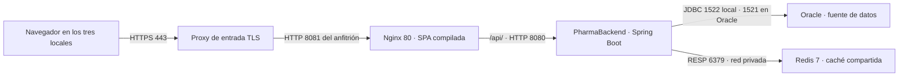

# PharmaBackend

API Spring Boot 4 con Oracle, autenticación JWT y caché Redis para [PharmaSoft](https://github.com/7inox/pharma-frontend).

## Despliegue en producción

### Arquitectura y puertos

El proxy TLS representa la instalación propuesta. En la práctica local, Chrome accede a
Nginx por `127.0.0.1:8081`. Los tres locales deben apuntar al mismo servicio central.
Actuator está en el backend y el proxy local reenvía solamente `/api/`.

### Variables de entorno

| Variable | Propósito |
| --- | --- |
| `SPRING_PROFILES_ACTIVE` | Seleccionar el perfil de producción. |
| `DB_URL`, `DB_USERNAME`, `DB_PASSWORD` | Dirección JDBC y cuenta Oracle con privilegios de la aplicación. |
| `JWT_SECRET` | Clave de firma en Base64, de al menos 32 bytes al decodificar. |
| `JWT_EXPIRACION_MINUTOS` | Duración de la sesión JWT. |
| `REDIS_HOST`, `REDIS_PORT` | Conexión al Redis compartido. El backend local usa loopback. |
| `SERVER_PORT` | Puerto del backend. Si se cambia, ajustar también el proxy de Nginx. |
| `CORS_ORIGINS` | Orígenes autorizados si se usa acceso cruzado. La SPA de producción usa el mismo origen. |

### Construcción, publicación y reversión

1. Guardar las referencias Git de ambos componentes y la versión de la configuración
   que se va a publicar. Asegurar un respaldo de Oracle comprobado y aprovisionar el
   esquema. El perfil de producción valida la estructura.
2. En el frontend, ejecutar `npm ci` y `npm run build`. En el backend, cargar las variables
   y ejecutar `./mvnw clean package` o `.\mvnw.cmd clean package`.
3. En el frontend, ejecutar `docker compose -f deploy/docker-compose.yml up -d`.
   Arrancar el JAR en el puerto 8080 y verificar Redis con `redis-cli ping`,
   Nginx con `docker compose ps` y el backend con `/actuator/health/readiness`.
   Comprobar login, recarga en /productos, una lectura del catálogo y métricas con un usuario autorizado.
4. Al publicar el frontend, copiar primero los JS/CSS nuevos con hash y reemplazar
   `index.html` al final. Mantener los archivos de la versión anterior mientras existan
   sesiones que puedan solicitar sus chunks. Conservar JAR y configuración anteriores.
5. Para revertir, restaurar el índice del frontend previo y el JAR/configuración previos.
   Revisar que el esquema sea compatible antes de arrancar. Invalidar las cachés de catálogo
   si cambió el formato serializado. Repetir health y las pruebas de humo.

### Estado de las buenas prácticas

| Buena práctica | Estado | Acción pendiente |
| --- | --- | --- |
| Secretos Oracle y JWT por entorno | Cumple | Configurar el gestor de secretos de la instalación. |
| Oracle en `validate` y migraciones versionadas | Parcial | Incorporar y probar Flyway sobre una copia del esquema. |
| Swagger y SQL de diagnóstico apagados en prod | Cumple | Verificarlo en cada liberación. |
| API y SPA del mismo origen | Cumple | Mantener el proxy y restringir los orígenes externos si se habilitan. |
| TLS para los tres locales | Pendiente | Terminar TLS en el proxy de entrada y renovar el certificado. |
| Budgets y nombres con hash | Cumple | Ejecutar el build de producción en la revisión de cambios. |
| HTML revalidable, estáticos con vigencia larga y API no-store | Cumple | Conservar los activos de la versión anterior durante el cambio. |
| Salud de Nginx, Redis y backend | Parcial | Conectar sondas a alertas y controlar latencia desde cada local. |
| Logs rotativos y código de seguimiento | Cumple | Centralizar el acceso restringido y acordar retención. |
| Versiones y reversión | Parcial | Etiquetar cada versión aprobada y ensayar la reversión de ambos componentes. |

### Prioridades para los tres locales

1. **Proteger el acceso.** Publicar un solo dominio HTTPS y limitar Oracle, Redis y las
   métricas administrativas a la red privada.
2. **Asegurar la recuperación de ventas.** Respaldar Oracle, medir el tiempo de recuperación
   y ensayar la restauración en un entorno aislado. Redis debe ser compartido por todas
   las instancias del backend para que la invalidación de stock sea común.
3. **Detectar incidentes desde los locales.** Medir disponibilidad y latencia por local.
   Alertar por readiness, errores HTTP y Redis caído. Usar el código de seguimiento para
   correlacionar cada incidencia con los logs.
